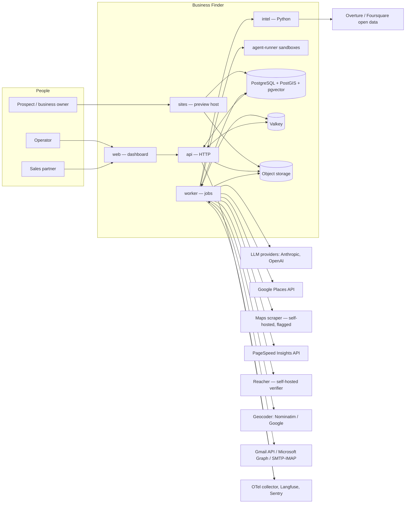
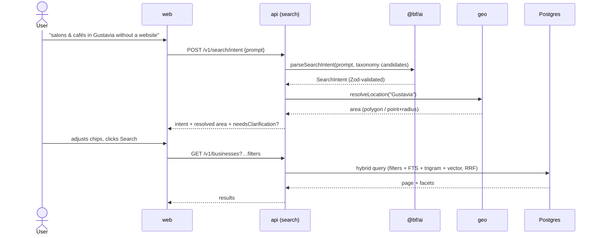
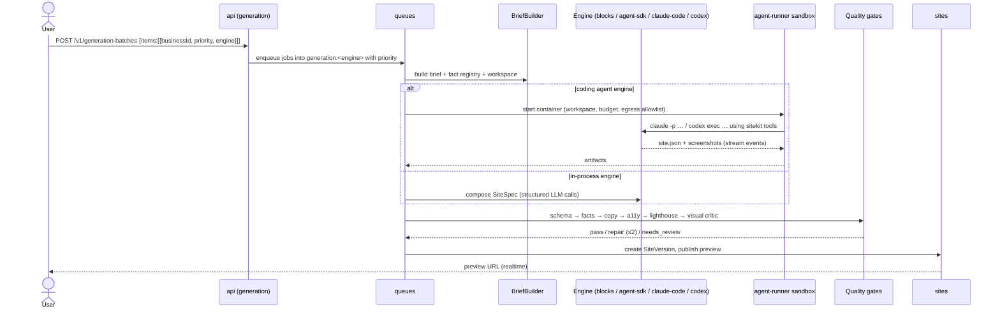

# Architecture — Business Finder

> Audience: engineers and coding agents. This document describes **how** the system is built and **where** things live. The **why** for each major choice lives in [ADRs](adr/). The language used here is defined in [DOMAIN.md](DOMAIN.md).

---

## 1. Principles

1. **Modular monolith + sidecars.** One TypeScript backend (`apps/api`) split into bounded-context modules with strict boundaries, run as two process types (HTTP and worker). Python (`services/intel`) and sandboxed coding agents (`services/agent-runner`) are sidecars for work that genuinely needs them. ([ADR-0002](adr/0002-typescript-first-with-python-sidecar.md), [ADR-0005](adr/0005-nestjs-modular-monolith.md))
2. **One primary datastore.** PostgreSQL with PostGIS, pgvector, full-text search and JSONB covers relational, geo, vector and document needs. Redis-compatible Valkey is used only for queues, rate limits, caching and pub/sub. ([ADR-0003](adr/0003-postgresql-as-primary-datastore.md))
3. **Schemas are the contract.** Zod schemas in `@bf/contracts` define every DTO, event and job payload. OpenAPI (for the web client) and JSON Schema → Pydantic (for Python) are generated from them.
4. **Everything async is idempotent and observable.** Jobs carry idempotency keys; every state change emits a domain event through a transactional outbox; progress streams to the UI over SSE.
5. **Humans approve outbound actions by default.** Automation prepares; people send. Fully automatic sending is an explicit, per-campaign opt-in that still passes the compliance gate.
6. **Compliance by design.** The compliance policy engine is a mandatory gate in the outbound pipeline — not a UI warning. ([ADR-0012](adr/0012-compliance-by-design-outreach.md))
7. **AI is a component with contracts, budgets and evals.** Every LLM call goes through `@bf/ai` (routing, structured output, cost ledger, tracing). Prompts are versioned files. Quality is measured with eval sets. ([ADR-0011](adr/0011-llm-gateway-ai-sdk-and-prompt-registry.md))
8. **Constrained generation over free-form code.** Websites are `SiteSpec` documents rendered by our own block library; agents (including Claude Code and Codex) edit the document with tools, they don't ship arbitrary apps. ([ADR-0009](adr/0009-schema-driven-website-builder.md), [ADR-0010](adr/0010-pluggable-agent-engines-in-sandboxes.md))

## 2. System context



## 3. Deployables

| Deployable | Tech | Port | Scales | Notes |
|---|---|---|---|---|
| `web` | Next.js (App Router), React 19, Tailwind v4, shadcn/ui | 3000 | horizontally, stateless | Dashboard only; talks to `api` via the generated typed client. |
| `api` | NestJS (`apps/api`, entry `src/main.ts`) | 4000 | horizontally | REST `/v1`, SSE, Better Auth at `/api/auth/*`, OpenAPI at `/docs`. |
| `worker` | NestJS standalone (`apps/api`, entry `src/worker.ts`) | — (metrics 9464) | horizontally per queue group | BullMQ processors, schedulers, outbox relay, agent orchestration. |
| `sites` | Next.js (`apps/sites`) | 3100 | horizontally, CDN-cacheable | Renders published `SiteVersion`s by hostname; read-only DB role. |
| `intel` | Python 3.13, FastAPI, Crawl4AI, DuckDB, scikit-learn | 8000 | horizontally | Stateless compute: site intel, open-data queries, ML training. Internal only. |
| `agent-runner` | Docker image (Node 24, Playwright, `claude`, `codex`, `sitekit`) | — | one container per job | Spawned by the worker; no DB/internal network access. |
| `postgres` | PostgreSQL 17 + PostGIS 3.5 + pgvector | 5432 | vertical | Custom image in `infra/docker/postgres`. |
| `valkey` | Valkey 8 (Redis-compatible) | 6379 | vertical | BullMQ, rate limiters, cache, pub/sub. |
| `minio` (dev) / S3-compatible (prod) | — | 9000 | managed | Screenshots, site assets, crawl artifacts, model artifacts. |
| `gmaps-scraper` | `gosom/google-maps-scraper` (REST mode) | 8080 | single | Feature-flagged provider. |
| `reacher` | `reacherhq/backend` | 8081 | single | Needs outbound port 25 (see BF-028). |
| `caddy` (prod) | Caddy 2 | 80/443 | single | TLS (incl. wildcard for sites via DNS challenge), reverse proxy. |
| `langfuse` (optional) | Langfuse | 3200 | single | LLM tracing/evals; can be swapped for Langfuse Cloud. |
| `mailpit` (dev) | Mailpit | 8025 | — | Catches all dev email. |

## 4. Monorepo layout

```
.
├── apps/
│   ├── web/                    Next.js dashboard
│   ├── api/                    NestJS: src/main.ts (http), src/worker.ts (jobs), src/modules/*
│   └── sites/                  Next.js multi-tenant site renderer
├── services/
│   ├── intel/                  Python service (uv project)
│   └── agent-runner/           Dockerfile + entrypoint for sandboxed agent runs
├── packages/
│   ├── tsconfig/               @bf/tsconfig — base/next/nest/library presets
│   ├── config/                 @bf/config — Zod env schemas, feature flags, constants
│   ├── contracts/              @bf/contracts — Zod schemas, branded IDs, errors, events, jobs, JSON Schema export
│   ├── db/                     @bf/db — Drizzle schema, migrations, client, seeds, test utils
│   ├── auth/                   @bf/auth — Better Auth server config + typed client
│   ├── ai/                     @bf/ai — LLM gateway, prompt registry, embeddings, evals harness, fake provider
│   ├── observability/          @bf/observability — pino logger, OTel bootstrap, metrics helpers
│   ├── queue/                  @bf/queue — queue registry, typed producers, job payload schemas
│   ├── api-client/             @bf/api-client — generated OpenAPI types, fetch client, TanStack Query helpers
│   ├── ui/                     @bf/ui — shadcn/ui components, data table, form kit
│   ├── site-schema/            @bf/site-schema — SiteSpec Zod schema, migrations, JSON Schema, fixtures
│   ├── site-blocks/            @bf/site-blocks — React block components + themes for generated sites
│   ├── sitekit/                @bf/sitekit — CLI + MCP server used by agents (validate/render/screenshot)
│   ├── email/                  @bf/email — composition, MIME, footer, list-unsubscribe, templating
│   └── testing/                @bf/testing — Testcontainers helpers, factories, fixture recorder
├── infra/
│   ├── docker/                 Dockerfiles (postgres, intel, agent-runner, app images)
│   ├── compose/                docker-compose.yml (dev), docker-compose.prod.yml
│   └── caddy/                  Caddyfile templates
├── scripts/                    Repo automation (ticket → issue sync, codegen helpers)
└── docs/
```

Dependency rules are listed in [AGENTS.md §3](../AGENTS.md#3-repository-map--dependency-rules) and enforced with Biome `noRestrictedImports` + a `scripts/check-boundaries.mjs` CI step (BF-009).

## 5. Backend architecture (`apps/api`)

### 5.1 Bounded contexts (NestJS modules)

| Module | Responsibility | Owns tables (prefix) | Tickets |
|---|---|---|---|
| `platform` | Shared kernel: clock, ids, transaction context, outbox, event bus, crypto, safe HTTP, resilience policies | `outbox_events` | BF-006, BF-012 |
| `identity` | Better Auth integration, users, organizations, members, invitations, API keys, permission policy | Better Auth tables, `api_keys` | BF-010 |
| `workspace` | Workspace settings, secrets vault, audit log, feature flags per org | `org_settings`, `secrets`, `audit_logs` | BF-011 |
| `realtime` | SSE gateway, notifications | `notifications` | BF-012 |
| `business-graph` | Golden records, sources, contacts, categories, media, reviews, entity resolution | `businesses`, `business_*`, `categories`, `category_mappings` | BF-014…BF-016 |
| `geo` | Location resolution, geocoding, areas, tiling | `geo_areas`, `geocode_cache` | BF-017 |
| `discovery` | Providers, discovery runs and tasks | `discovery_runs`, `discovery_tasks`, `provider_usage` | BF-018…BF-020 |
| `search` | Intent parsing, hybrid search, saved searches, lists | `saved_searches`, `lists`, `list_items` | BF-021…BF-023 |
| `crm` | Org-scoped business state: pipeline, owner, tags, notes, tasks, activity, user-asserted facts | `org_businesses`, `notes`, `tasks`, `activities`, `org_business_facts` | BF-024, BF-040 (facts overlay) |
| `enrichment` | Enrichment runs, site intel, PSI, email verification, reviews mining, audits | `enrichment_*`, `website_snapshots`, `website_audits`, `review_insights` | BF-026…BF-030 |
| `scoring` | Feature registry, scoring profiles, scores, outcome models (training datasets, shadow scores) | `scoring_profiles`, `business_scores`, `business_score_history`, `scoring_models`, `label_definitions` | BF-031, BF-032, BF-059 |
| `sites` | Sites, versions, publications, assets and sourcing, leads, views, chat editing, custom domains, live sites | `sites`, `site_*` | BF-035, BF-036 (renderer read model), BF-037, BF-038, BF-047, BF-048, BF-062 |
| `generation` | Batches, jobs, engines, sandbox orchestration, brief builder and fact registry snapshots, quality gates | `generation_*`, `fact_registry_snapshots` | BF-039…BF-046 |
| `compliance` | Jurisdiction policies, decisions, suppression, lawful basis, unsubscribe tokens, data-subject requests, retention | `compliance_*`, `suppression_*`, `lawful_basis_records`, `offer_relevance`, `unsubscribe_tokens`, `dsr_requests`, `retention_runs` | BF-049, BF-055 |
| `outreach` | Mailboxes, templates, drafts, messages, threads, sequences, replies, deliverability, call/WhatsApp assist | `mailbox*`, `email_*`, `outbound_*`, `inbound_messages`, `sequence_*`, `manual_contact_logs` | BF-050…BF-054, BF-056, BF-057 |
| `analytics` | Fact table fed by domain events, semantic metrics layer, rollups, metrics endpoints | `analytics_*` | BF-058 |

Modules communicate **only** through (a) application-layer interfaces exported from a module's `index.ts` (synchronous queries), or (b) domain events (asynchronous). A module never reads another module's tables directly; read models that need joins across contexts live in `analytics` or are exposed by the owning module's query use case.

### 5.2 Module anatomy

```
modules/business-graph/
├── domain/
│   ├── business.entity.ts            # aggregate root with invariants
│   ├── value-objects/phone.ts        # E.164, normalization, equality
│   ├── events.ts                     # BusinessCreated, BusinessMerged, …
│   └── errors.ts                     # BusinessNotFoundError, MergeConflictError, …
├── application/
│   ├── commands/ingest-source-record.command.ts
│   ├── queries/get-business.query.ts
│   ├── ports/business.repository.ts  # interface
│   └── mappers/
├── infrastructure/
│   ├── drizzle-business.repository.ts
│   └── processors/ingest.processor.ts
├── interface/
│   ├── http/businesses.controller.ts
│   └── http/dto/                     # thin: re-export from @bf/contracts
├── business-graph.module.ts
└── index.ts                          # public surface for other modules
```

### 5.3 Cross-cutting concerns

| Concern | Implementation |
|---|---|
| Validation | Zod schemas from `@bf/contracts` via a global `ZodValidationPipe`; responses serialized through schemas in dev/test (catches drift). |
| Errors | `DomainError` hierarchy → global filter → RFC 9457 problem+json with `type`, `title`, `status`, `detail`, `instance`, `code`, `traceId`. |
| Auth | Better Auth session (cookie) or API key (`Authorization: Bearer bf_…`). Guard resolves `RequestContext {userId, orgId, role, permissions}` into AsyncLocalStorage. |
| AuthZ | `@RequirePermission('sites:publish')` decorator + `PolicyService` (RBAC matrix in `@bf/contracts/permissions.ts`); repositories require `orgId` for org-scoped tables. Postgres RLS added as defense in depth in BF-060. |
| Transactions | `TransactionContext` (AsyncLocalStorage) holding the Drizzle transaction; `@Transactional()` decorator on command handlers; repositories use the ambient tx. |
| Events | Aggregates record events; repositories persist them into `outbox_events` in the same transaction; the relay publishes to the in-process bus and BullMQ. |
| Resilience | `cockatiel` policies per external dependency: timeout, retry (exp backoff + jitter), circuit breaker, bulkhead. Wrapped as decorators around ports. |
| Rate limiting | `@nestjs/throttler` with Valkey storage for HTTP; token buckets per provider/mailbox in Valkey for jobs. |
| Caching | Read-through cache helper (Valkey) for idempotent provider calls (geocoding, PSI per URL/day); never cache across orgs unless data is global. |
| Config | `@bf/config` validates env at boot; fails fast with a readable report. |
| Time | `Clock` port; `SystemClock` in prod, `FixedClock` in tests. |
| IDs | UUIDv7 via `newId()`; branded types (`BusinessId`, `OrgId`) in contracts. |

### 5.4 HTTP API surface (overview)

All under `/v1`, JSON, cursor pagination (`?cursor=&limit=`), filters as query params validated by Zod, problem+json errors, `Idempotency-Key` header honoured on POSTs that create side effects. Full conventions: [docs/conventions/api.md](conventions/api.md).

| Resource | Examples |
|---|---|
| Identity | `/api/auth/*` (Better Auth), `GET /v1/me`, `POST /v1/api-keys` |
| Workspace | `GET/PATCH /v1/workspace/settings`, `PUT /v1/workspace/secrets/:name`, `GET /v1/audit-logs` |
| Search | `POST /v1/search/intent`, `GET /v1/businesses`, `GET /v1/businesses/facets`, `/v1/saved-searches`, `/v1/lists` |
| Discovery | `POST /v1/discovery-runs`, `GET /v1/discovery-runs/:id`, `POST /v1/discovery-runs/:id/cancel` |
| Business | `GET /v1/businesses/:id`, `PATCH /v1/businesses/:id/state`, `/notes`, `/tasks`, `/activity`, `POST /v1/businesses/merge` |
| Enrichment | `POST /v1/businesses/:id/enrich`, `GET /v1/businesses/:id/audit` |
| Scoring | `/v1/scoring/profiles`, `GET /v1/businesses/:id/scores` |
| Sites | `/v1/sites`, `/v1/sites/:id/versions`, `POST /v1/sites/:id/publish`, `/v1/sites/:id/assets` |
| Generation | `POST /v1/generation-batches`, `GET /v1/generation-batches/:id`, `POST /v1/generation-jobs/:id/cancel`, `GET /v1/generation-jobs/:id/events` (SSE) |
| Outreach | `/v1/mailboxes`, `/v1/templates`, `POST /v1/outreach/drafts`, `POST /v1/outreach/messages`, `/v1/sequences`, `/v1/inbox/threads` |
| Compliance | `POST /v1/compliance/evaluate`, `/v1/suppressions`, `/v1/compliance/policies` |
| Realtime | `GET /v1/realtime` (SSE, org-scoped) |
| Public (no session) | `POST /v1/public/sites/leads`, `GET/POST /v1/public/unsubscribe/:token`, `POST /v1/public/sites/views` — rate-limited, signed where applicable |

## 6. Data architecture

### 6.1 Global graph vs org-scoped CRM

Facts about the world (a business exists, its website, its phone, its reviews, its audit) are **global** and shared across workspaces — they are expensive to fetch and identical for everyone. What a workspace *does* with a business (status, notes, scores under its own profiles, outreach) is **org-scoped**. See [ADR-0008](adr/0008-global-business-graph-and-org-scoped-crm.md).

```mermaid
erDiagram
  BUSINESSES ||--o{ BUSINESS_SOURCES : "has provenance"
  BUSINESSES ||--o{ BUSINESS_CONTACTS : has
  BUSINESSES ||--o{ BUSINESS_CATEGORIES : "classified as"
  CATEGORIES ||--o{ BUSINESS_CATEGORIES : ""
  CATEGORIES ||--o{ CATEGORIES : "parent of"
  BUSINESSES ||--o{ BUSINESS_MEDIA : has
  BUSINESSES ||--o{ BUSINESS_REVIEWS : has
  BUSINESSES ||--o{ WEBSITE_SNAPSHOTS : "crawled as"
  WEBSITE_SNAPSHOTS ||--o| WEBSITE_AUDITS : "audited in"
  BUSINESSES ||--o| REVIEW_INSIGHTS : summarized

  ORGANIZATIONS ||--o{ ORG_BUSINESSES : tracks
  BUSINESSES ||--o{ ORG_BUSINESSES : ""
  ORG_BUSINESSES ||--o{ NOTES : ""
  ORG_BUSINESSES ||--o{ TASKS : ""
  ORGANIZATIONS ||--o{ SCORING_PROFILES : defines
  SCORING_PROFILES ||--o{ BUSINESS_SCORES : produces

  ORGANIZATIONS ||--o{ SITES : owns
  BUSINESSES ||--o{ SITES : "previewed by"
  SITES ||--o{ SITE_VERSIONS : "immutable versions"
  SITES ||--o{ SITE_PUBLICATIONS : "published as"
  ORGANIZATIONS ||--o{ GENERATION_BATCHES : runs
  GENERATION_BATCHES ||--o{ GENERATION_JOBS : contains
  GENERATION_JOBS ||--o| SITE_VERSIONS : produces

  ORGANIZATIONS ||--o{ MAILBOXES : connects
  ORGANIZATIONS ||--o{ OUTBOUND_MESSAGES : sends
  BUSINESS_CONTACTS ||--o{ OUTBOUND_MESSAGES : "addressed to"
  OUTBOUND_MESSAGES ||--o{ INBOUND_MESSAGES : "replied by"
  OUTBOUND_MESSAGES ||--|| COMPLIANCE_DECISIONS : "allowed by"
  ORGANIZATIONS ||--o{ SUPPRESSIONS : maintains
```



### 6.2 Conventions

- Primary keys `uuid` (UUIDv7), `created_at`/`updated_at` `timestamptz`. Org-scoped tables carry `organization_id uuid not null` with a composite index leading on it.
- Money and costs: `numeric(12,6)` in USD for provider/LLM costs; currency-aware fields store ISO-4217 code alongside.
- Geography: `geography(Point, 4326)` for locations; `geography(MultiPolygon, 4326)` for areas; GiST indexes.
- Area geometry in TypeScript (BF-017): tiling and clipping for discovery are pure functions on Turf.js (`geo/domain/tiling.ts`), so they run in unit tests without a database; PostGIS does storage-side work (containment, distance, area, trigram name lookup). GeoJSON positions are `[lng, lat]`; APIs speak `{ lat, lng }`, converted only in `geo/domain/geometry.ts`.
- Text search: generated `tsvector` columns using `unaccent` and a language-aware config (`simple` + `french` + `english` combined weights); `pg_trgm` GIN on names. `businesses.search_tsv` (BF-022) weighs name A, category labels B (`category_text`, kept by triggers: ancestors' labels and synonyms, so "restaurant" finds pizzerias), locality/address C, short description D.
- Listing search (BF-022, `search` module): a Specification of filters → parameterized SQL; free text ranked by three rankers (full text, name trigram, embeddings — ≤ 200 candidates each) fused with RRF (k = 60); other sorts use keyset cursors with nulls last; facets drop their own dimension's filter and, with text, count the ranked results.
- Vectors: `vector(<dims>)` with HNSW index (`vector_cosine_ops`); the embedding model and dimension are recorded per row (`embedding_model`), re-embedding is a background job.
- Hierarchies: `ltree` path on `categories` for "category and all descendants" filters.
- Provenance: per-field provenance in `attributes jsonb` on golden records: `{ "<field>": { "value": …, "source": "google_places", "sourceId": "…", "confidence": 0.92, "observedAt": "…" } }`.
- Retention: `business_sources.expires_at` enforced by `system.retention`; provider-specific TTLs (e.g. Google Places content) in config ([ADR-0013](adr/0013-discovery-providers-and-data-licensing.md)).
- Migrations: Drizzle Kit generated SQL, reviewed, forward-only; destructive changes follow expand → migrate → contract across separate PRs ([ADR-0004](adr/0004-drizzle-orm-and-migration-ownership.md)). `runMigrations` (`@bf/db`) keeps Drizzle's journal but runs each migration in its own transaction, and none for a migration starting with `-- bf:no-transaction` (one `CREATE INDEX CONCURRENTLY` per such migration; `packages/db/README.md`).

## 7. Asynchronous processing

### 7.1 Queue catalog

| Queue | Producer | Default concurrency | Retry policy | Idempotency key |
|---|---|---|---|---|
| `discovery.plan` | `StartDiscoveryRun`, reconciler | 2 | 3× exp | `runId:attemptKey` |
| `discovery.fetch` | plan step, fetch step (splits, next pages), reconciler | 4, provider limiter | 5× exp + jitter | `taskId:attempt[:window]` |
| `discovery.ingest` | fetch step, reconciler | 4 | 3× | `taskId:attemptKey` (records wait on the task row) |
| `enrichment-run` | `StartEnrichment` (manual, bulk, `discovery.business.found`, nightly refresh), reconciler | 4 | 3× | `runId:attemptKey` |
| `enrichment-step` | `advance` (steps whose dependencies are terminal), retries, reconciler | 8 | per step (engine: 3 attempts, backoff; open circuit not counted) | `stepRowId:attempt[:retryKey]` (freshness by `businessId:step:inputHash`) |
| `enrichment-refresh` | scheduler (worker, hourly check) | 1 | 3× | `refresh:yyyy-mm-dd` |
| `scoring.compute` | `BusinessEnriched`, profile change | 8 | 3× | `orgId:businessId:profileVersion:featureHash` |
| `search.embed` | `BusinessUpdated` | 4 | 5× | `businessId:model:textHash` |
| `generation.blocks` | `GenerationService` | 6 | 2× then failover | `jobId:attempt` |
| `generation.claude-agent-sdk` | `GenerationService` | 2 | 2× then failover | `jobId:attempt` |
| `generation.claude-code` | `GenerationService` | 2 | 2× then failover | `jobId:attempt` |
| `generation.codex` | `GenerationService` | 2 | 2× then failover | `jobId:attempt` |
| `generation.quality` | engine completion | 2 | 2× | `siteVersionId` |
| `sites.screenshot` | `SitePublished` | 2 | 3× | `siteVersionId:viewport` |
| `outreach.send` | outbound pipeline | per-mailbox limiter | 3× (never on hard bounce) | `outboundMessageId` |
| `outreach.tick` | repeatable (every minute) | 1 | — | minute bucket |
| `outreach.sync` | push webhook / repeatable | 2 | 5× | `mailboxId:cursor` |
| `outreach.triage` | `InboundMessageReceived` | 4 | 3× | `inboundMessageId` |
| `system.outbox` | repeatable + `LISTEN/NOTIFY` | 1 | — | `eventId` |
| `system.retention` | repeatable (daily) | 1 | — | date |
| `sites.expire` | repeatable (hourly) | 1 | — | hour |

Concurrency values are configuration (`QUEUE_CONCURRENCY__GENERATION_CODEX=2`, …) and also editable per workspace for generation engines (bounded by the global maximum).

### 7.2 Patterns

- **Fan-out through rows, not BullMQ flows**: discovery runs grow their tree while running (quadtree splits, next pages), so each step enqueues its follow-ups and a locked `finalize` detects fan-in (BF-020). Enrichment runs are a DAG, not a tree (a step may need several others), so their step rows hold `depends_on`: under the run's row lock, `advance` skips steps whose dependency failed or was skipped, enqueues the ready ones and finalizes the run with `business.enriched` (BF-027, ADR-0006). Either way the database says what is left to do and the reconciler rebuilds lost jobs from it.
- **DB-backed scheduler** for anything with business-time semantics (sequence steps, preview expiry): rows carry `next_run_at`; a one-minute tick claims due rows with `SELECT … FOR UPDATE SKIP LOCKED` and enqueues work. Survives Valkey loss; easy to reason about.
- **Transactional outbox**: domain events are written to `outbox_events` inside the business transaction; the relay (worker) publishes them and marks them dispatched. Consumers are idempotent.
- **Realtime**: workers publish `RealtimeEvent`s to Valkey channel `rt:org:<orgId>`; the API's `/v1/realtime` SSE endpoint fans them out to that org's connected clients; the web app maps events to TanStack Query invalidations. Job-scoped streams (`/v1/generation-jobs/:id/events`) replay the persisted event log first, then tail live events.

## 8. Key flows

### F1 — Natural-language search



### F2 — Discovery run

```mermaid
sequenceDiagram
  participant A as api (discovery)
  participant Q as queues
  participant P as providers
  participant BG as business-graph
  A->>Q: discovery.plan(runId)
  Q->>Q: tile area × categories → N task rows + fetch jobs
  loop each task (reserve budget → call → complete + follow-ups in one transaction)
    Q->>P: provider.fetchPage(task)
    P-->>Q: SourceRecord[] (saturated → 4 child tiles; next page → continuation)
    Q->>BG: ingest(page) — normalize → block → match → merge, then track for the workspace
  end
  Q->>Q: finalize when no open task and no pending ingest (also by the reconciler)
  BG-->>Q: BusinessCreated / BusinessUpdated (outbox)
  Q->>Q: enrichment.run per new business (budget permitting)
  Q-->>A: run completed (counts, cost) → realtime
```

### F3 — Enrichment and scoring

A run starts from the business page or bulk bar (`POST /v1/businesses/:id/enrich`, `/v1/enrichment/bulk`), a discovery run with `autoEnrich` (`discovery.business.found`) or the nightly refresh of stale steps. The planner resolves the requested steps and their dependencies into a DAG, skips fresh ones (per-step TTL and input hash) and what the workspace's monthly budget cannot pay; steps then run as their dependencies finish: `site_intel` (intel service, BF-026 — the website becomes a `website` source through ingestion) → `psi`, `email_verify`, `reviews`, `vision_audit` (BF-028–030, registered by their modules) → `business.enriched` → `scoring.compute` for every workspace tracking the business → `ScoreUpdated` → realtime (`enrichment.run.progressed` all along).

### F4 — Batch site generation



### F5 — One-click send

`POST /v1/outreach/messages {businessId, contactId, draft}` → `ComplianceService.evaluate()` (jurisdiction policy + suppression + "no solicitation" markers + contact verification) → decision persisted → `outbound_messages` row (`queued`) in the same transaction → outbox → `outreach.send` picks a mailbox (capacity, window, rotation) → provider API send with RFC 8058 headers → `sent` + thread recorded → realtime.

### F6 — Reply triage

Provider push/poll → `inbound_messages` (dedup by provider id) → thread match (`In-Reply-To`/`References`) → auto-reply/bounce detection → `outreach.triage` (LLM classification with confidence) → actions (stop sequence, pipeline status, suppression on unsubscribe intent, task, notification) → suggested reply draft.

## 9. AI architecture

`@bf/ai` is the only place that talks to model providers ([ADR-0011](adr/0011-llm-gateway-ai-sdk-and-prompt-registry.md)).

- **Providers** via the Vercel AI SDK (`@ai-sdk/anthropic`, `@ai-sdk/openai`), plus a `fake` provider for tests.
- **Routing table** (config): `task → { provider, model, temperature, maxTokens, timeoutMs, fallback }`. Defaults: fast tier (classification, extraction, triage) → `claude-haiku-5-5`; smart tier (intent parsing, drafting, copywriting, critic) → `claude-sonnet-5-5`; agent tier (site generation agents) → `claude-opus-5-5`. Model IDs are env-configurable.
- **Prompt registry**: `packages/ai/prompts/<task>.v<N>.md` with frontmatter (`task`, `version`, `model_tier`, `output_schema`), rendered with typed variables. Changing a prompt = new version + eval run.
- **Structured output** everywhere (`generateObject` with Zod); validation failure → one repair attempt with the error → typed failure.
- **Safety**: untrusted content (crawled pages, reviews, emails) is wrapped in `<untrusted_data source="…">` blocks, never in system prompts; instructions inside it are ignored by policy; tools exposed to agents are least-privilege; outputs are schema-validated and fact-checked.
- **Cost & tracing**: every call records `llm_calls` (org, feature, model, tokens, cost, latency, outcome) and an OTel span exported to Langfuse.
- **Embeddings & RAG**: `embed()` with a configurable model (default `text-embedding-3-small`, 1536 dims; Voyage supported); business profile text is embedded for semantic search; taxonomy categories are embedded to ground intent parsing (retrieve top-k candidate categories, then constrain the LLM to choose among them).
- **Evals**: datasets in `packages/ai/evals/<task>/*.jsonl`, run with `pnpm eval`; thresholds per task (e.g. intent category accuracy ≥ 95%).

## 10. Website platform

- **`SiteSpec`** (`@bf/site-schema`): `{ schemaVersion, locales, defaultLocale, theme, navigation, pages[{ slug, title, seo, blocks[] }], assets, settings }`. Blocks are a discriminated union by `type` with versioned prop schemas. Localized strings are `{ fr: string, en: string }`. Schema migrations ("upcasters") keep old versions renderable.
- **Block library** (`@bf/site-blocks`): React Server Components (no client JS unless a block needs it, e.g. gallery lightbox, contact form), Tailwind with CSS variables from theme tokens, 4 design styles (luxe, modern, warm, minimal), each block × style tested visually.
- **Renderer** (`apps/sites`): resolves hostname → site → active publication → `SiteVersion`; renders pages per locale (`/`, `/en/...`); ISR with tag revalidation on publish; preview banner and `noindex` on previews; contact/claim form posts to the public API; cookieless view beacon.
- **Editor**: Puck in `apps/web` using the same block components and field configs derived from the block schemas; edits save as new versions.
- **Hosting**: `https://<slug>.<SITES_BASE_DOMAIN>` for previews (wildcard TLS); custom domains later (Caddy on-demand TLS with an `ask` endpoint, or the Vercel Domains API if `sites` is deployed there).

## 11. Generation agents

([ADR-0010](adr/0010-pluggable-agent-engines-in-sandboxes.md))

```ts
// @bf/contracts — generation
interface AgentEngine {
  readonly id: 'blocks' | 'claude-agent-sdk' | 'claude-code' | 'codex' | (string & {});
  readonly capabilities: { sandboxed: boolean; supportsChatEdit: boolean; maxParallel: number };
  run(ctx: EngineRunContext, signal: AbortSignal): AsyncIterable<EngineEvent>;
}
type EngineEvent =
  | { type: 'status'; phase: 'preparing' | 'running' | 'validating' }
  | { type: 'log'; level: 'info' | 'warn' | 'error'; message: string }
  | { type: 'tool_call'; tool: string; summary: string }
  | { type: 'file_change'; path: string }
  | { type: 'usage'; inputTokens: number; outputTokens: number; costUsd: number }
  | { type: 'artifact'; kind: 'site_spec' | 'screenshot'; ref: string }
  | { type: 'error'; code: string; message: string; retryable: boolean }
  | { type: 'done'; siteSpecRef: string };
```

- **Workspace** given to every engine: `BRIEF.md`, `business.json` (facts), `facts.json` (fact registry), `site.json` (starter spec for the chosen page plan), `blocks/` (catalog: one markdown + JSON Schema per block), `AGENTS.md` (rules for the site agent), `assets/` (candidate images with license metadata).
- **Toolbelt**: `sitekit` CLI and MCP server — `validate`, `render`, `screenshot`, `lint-copy`, `catalog`, `facts`. Engines must end with `sitekit validate` passing.
- **Sandbox**: the worker starts an `agent-runner` container via the Docker Engine API with CPU/memory/pids limits, read-only root FS, tmpfs workspace, non-root user, egress through an allowlisting proxy (model API hosts + approved asset CDNs only), wall-time and budget limits. `SandboxProvider` interface allows E2B / Vercel Sandbox / Daytona later.
- **CLI invocation** (exact flags are verified against current docs in BF-044): Claude Code headless (`claude --bare -p … --output-format stream-json --verbose --permission-mode dontAsk --allowedTools … --max-budget-usd …`) and Codex non-interactive (`codex exec --json --sandbox workspace-write --skip-git-repo-check …`). Their JSONL streams are normalized into `EngineEvent`s.
- **Quality gates** (Chain of Responsibility): schema → fact check → copy lint → accessibility (axe) → Lighthouse → visual critic (vision model with rubric) → optional repair loop (max 2) → quality score on the version.

## 12. Outreach architecture

- **Mailbox adapters** (`MailboxProvider` port): Gmail API (OAuth, `users.messages.send`, `watch` + history sync), Microsoft Graph (`sendMail`, subscriptions/delta), SMTP + IMAP (nodemailer + ImapFlow) fallback.
- **Outbound pipeline**: draft → compliance decision → `outbound_messages(queued)` → send worker (mailbox selection by capacity/window/rotation, per-mailbox and per-recipient-domain token buckets, jitter) → `sent | failed | bounced`. Exactly-once effect via idempotency key and provider message-id reconciliation.
- **Sequences**: definitions with steps; enrollments advanced by the DB scheduler; stop conditions evaluated at each step and on events.
- **Inbound**: dedupe by provider message id, thread matching, auto-reply/bounce parsing, AI triage, actions.
- **Footer & headers**: identity, postal address, reason/source line, unsubscribe link; `List-Unsubscribe` + `List-Unsubscribe-Post: List-Unsubscribe=One-Click` (RFC 8058). Open/click tracking **off** by default (deliverability and privacy); preview-site visits are measured on our own domain instead.

## 13. Security architecture

Details: [docs/conventions/security.md](conventions/security.md). Threat model: BF-060.

- **AuthN**: Better Auth sessions (HttpOnly, Secure, SameSite=Lax, cross-subdomain cookie for `app.`/`api.`), TOTP 2FA, rate-limited auth routes; API keys hashed (SHA-256 + pepper), scoped, revocable.
- **AuthZ**: RBAC matrix + org scoping in repositories; RLS policies as a second layer (BF-060).
- **Secrets**: envelope encryption (AES-256-GCM data keys, master key from env/KMS); secrets decrypted only in the worker/API memory when used.
- **Untrusted input**: Zod at every boundary; SSRF-safe HTTP client for crawling/screenshots; HTML sanitization for any user/agent-provided rich text; strict CSP on `web` and `sites`.
- **Sandboxing**: agents in containers without DB or internal network; per-run keys with budget caps; artifacts validated before persistence.
- **Supply chain**: lockfiles, Renovate (later), `pnpm audit`/OSV scan and gitleaks in CI, pinned base images.

## 14. Observability

- **Logs**: pino JSON (TS) / structlog JSON (Python) with `traceId`, `requestId`, `orgId`, `jobId`; redaction of secrets/PII paths.
- **Traces**: OpenTelemetry SDK in api/worker/intel; HTTP, Postgres, Valkey, BullMQ and LLM spans; OTLP export (collector → Tempo/Jaeger or vendor). LLM spans also to Langfuse.
- **Metrics**: Prometheus endpoints (`/metrics`): HTTP latency, queue depth/age, job durations/failures, provider quota usage, LLM cost, mailbox sends/bounces.
- **Errors**: Sentry (optional, DSN-configured) for web, api, worker, sites.
- **Dashboards & alerts**: queue backlog age, failed-job rate, mailbox auto-pause, bounce rate, LLM spend vs budget, generation failure rate (BF-061).

## 15. Environments & deployment

| Env | Where | How |
|---|---|---|
| Local | Developer machine | `pnpm infra:up` (compose) + `pnpm dev`; Mailpit; MinIO; fake LLM provider optional. |
| CI | GitHub Actions | Unit + integration (service containers / Testcontainers) + E2E on compose; image builds to GHCR. |
| Staging | 1 VPS, US-East (closest major region to the Caribbean) | `docker compose -f infra/compose/docker-compose.prod.yml` behind Caddy; every green `main` build deploys itself: migrate → update → health gate through Caddy → automatic rollback; nightly `pg_dump` to object storage ([runbook](runbooks/staging-setup.md), BF-025). |
| Production | 1–2 VPS US-East + S3-compatible storage + managed or self-managed Postgres | Same images, tagged releases, PITR backups, monitoring (BF-061). |

Domains (configuration): `app.<domain>` → web, `api.<domain>` → api, `*.<sites-domain>` → sites. Sending domains are separate from the main domain.

## 16. Technology stack

Versions: use the latest stable release at implementation time and pin it in the lockfile. Majors listed are minimums.

| Layer | Choice |
|---|---|
| Runtime | Node.js 24 LTS, pnpm 10 (corepack), Turborepo 2; Python 3.13 with uv |
| Language | TypeScript (strict, `exactOptionalPropertyTypes`, `noUncheckedIndexedAccess`) |
| Web | Next.js (App Router), React 19, Tailwind CSS v4, shadcn/ui, TanStack Query v5, TanStack Table v8, react-hook-form + Zod, nuqs (URL state), next-intl, MapLibre GL, Recharts, cmdk, sonner |
| API | NestJS 11, `@nestjs/bullmq`, `@nestjs/terminus`, `@nestjs/throttler`, helmet, cockatiel |
| Validation | Zod v4 (+ JSON Schema export), OpenAPI 3.1 generation |
| Data | PostgreSQL 17, PostGIS 3.5, pgvector, pg_trgm, unaccent, ltree, citext; Drizzle ORM + Drizzle Kit; postgres.js |
| Queues/cache | Valkey 8, BullMQ 5 |
| Auth | Better Auth (organization, two-factor, admin, api-key plugins), NestJS integration |
| AI | Vercel AI SDK (`ai`, `@ai-sdk/anthropic`, `@ai-sdk/openai`), Claude Agent SDK (`@anthropic-ai/claude-agent-sdk`), Claude Code CLI, OpenAI Codex CLI, Langfuse |
| Site builder | `@bf/site-schema` + `@bf/site-blocks`, Puck editor (MIT core), Playwright, axe-core, Lighthouse CI, sharp |
| Python | FastAPI, Pydantic v2, pydantic-settings, httpx, Crawl4AI, Playwright, DuckDB (spatial, httpfs), scikit-learn, structlog, OpenTelemetry |
| Email | googleapis (Gmail), Microsoft Graph client, nodemailer, ImapFlow, mailparser |
| Testing | Vitest, Testcontainers, MSW, Supertest, Playwright, pytest, respx, hypothesis, pytest-recording |
| Quality | Biome, ruff, mypy (strict), lefthook, commitlint, knip |
| Infra | Docker, Docker Compose, Caddy 2, GitHub Actions, GHCR |

## 17. Configuration & feature flags

- Env naming: `BF_<AREA>__<KEY>` is not required; keep names conventional (`DATABASE_URL`, `VALKEY_URL`, `ANTHROPIC_API_KEY`, `SITES_BASE_DOMAIN`, …) but **declare every variable** in `@bf/config` with description, default and whether it is secret.
- Per-app schemas (`apiEnv`, `workerEnv`, `webEnv`, `sitesEnv`); `pnpm env:check` prints missing/invalid vars.
- Feature flags: static (env) for infrastructure-level features (`FEATURE_MAPS_SCRAPER=false`), and per-workspace flags in `org_settings.features` for product features (`autoSend`, `codingEngines`).
