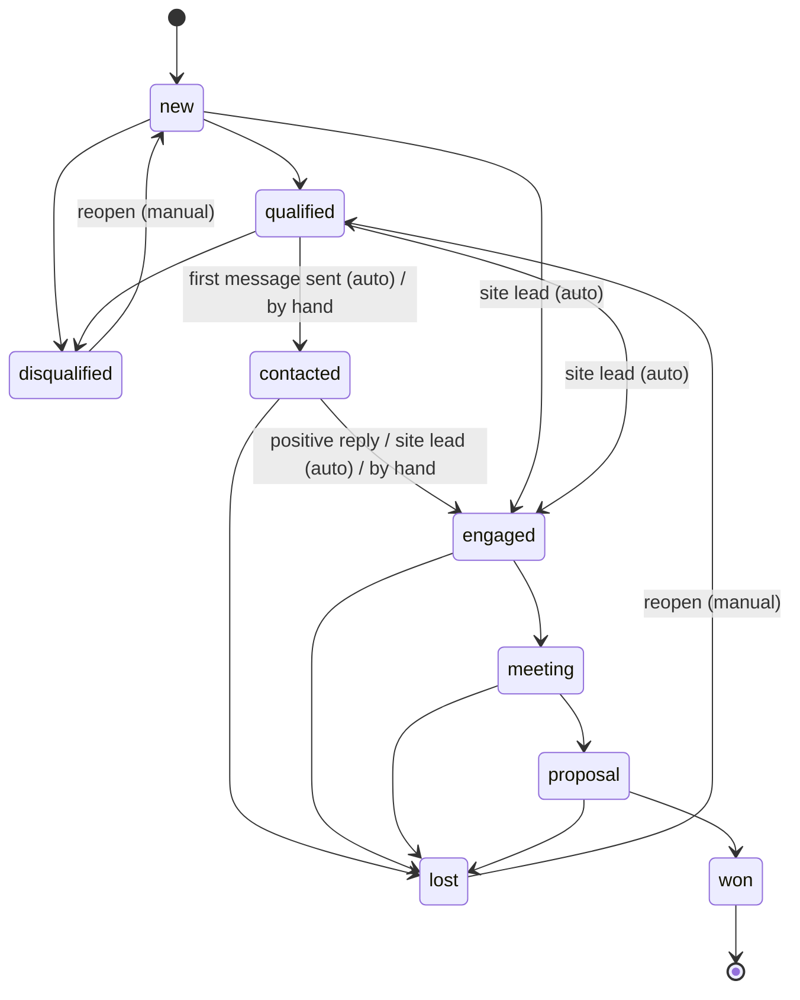
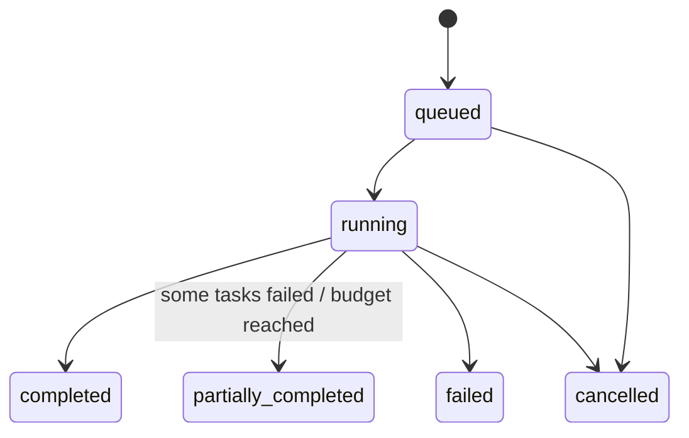
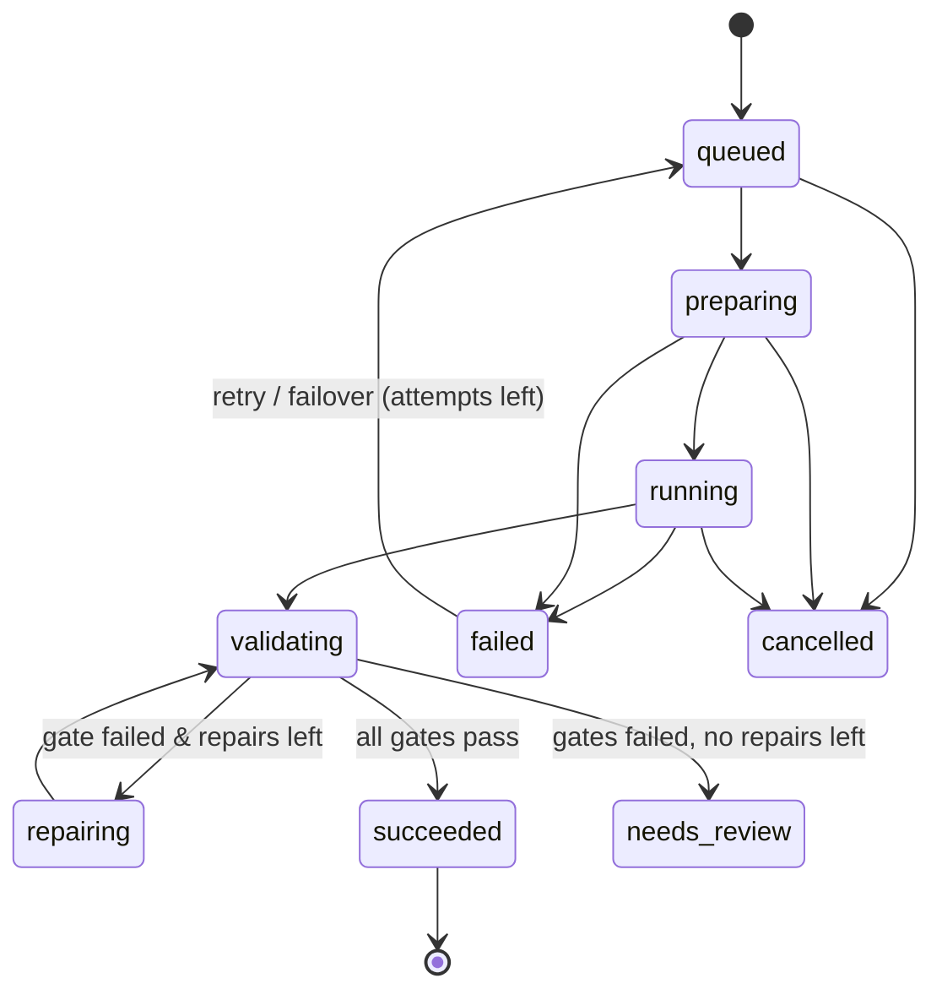
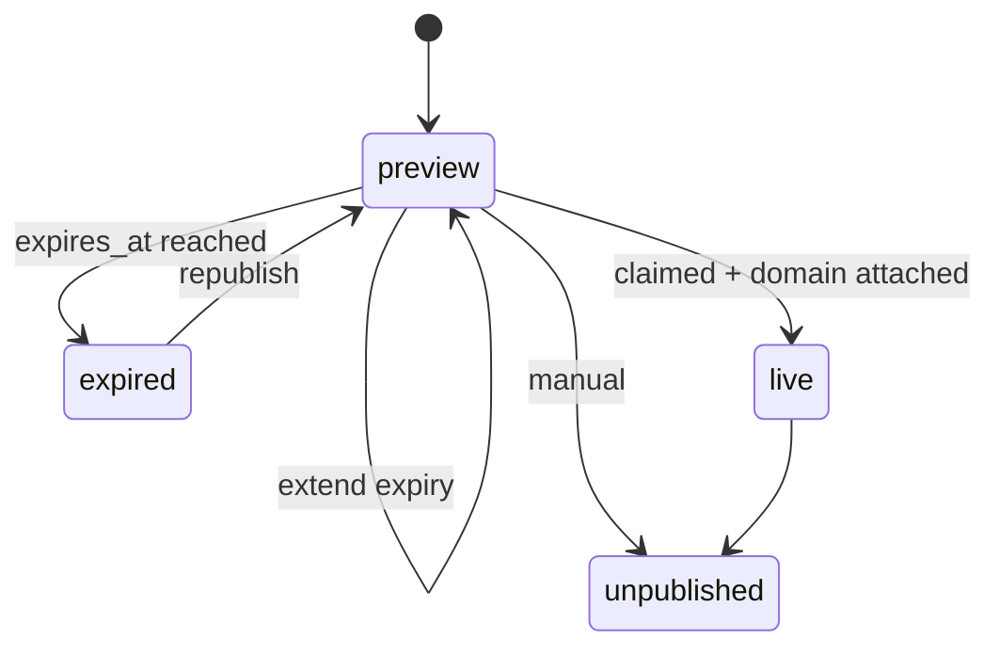
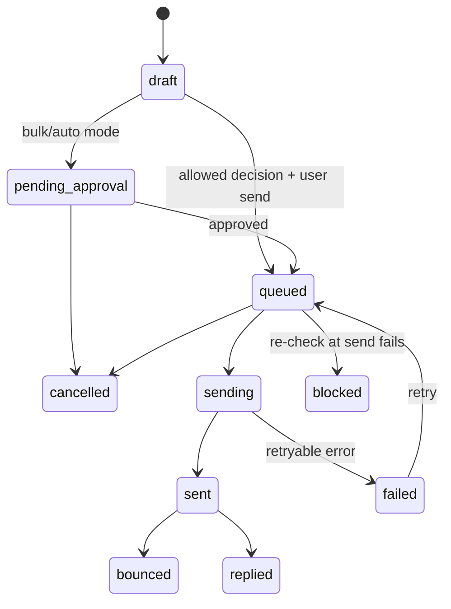
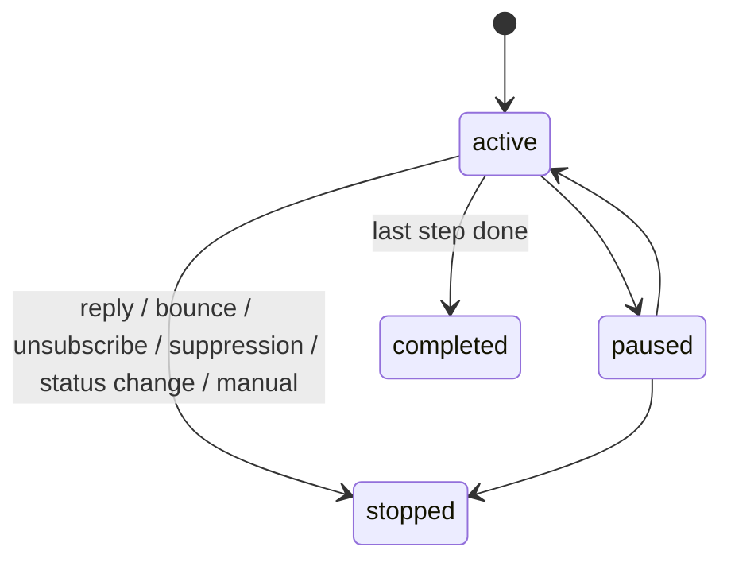
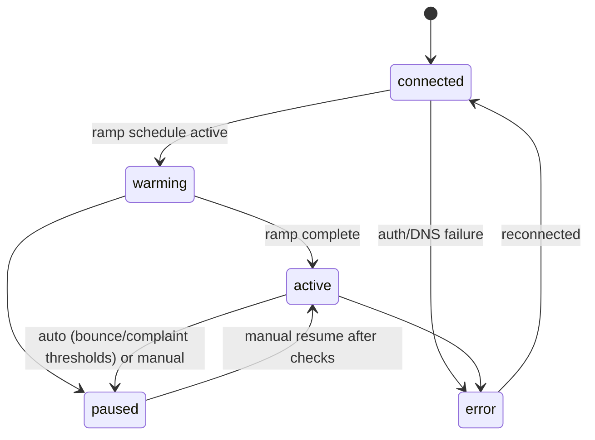
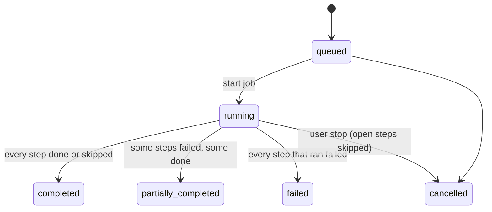

# Domain model — Business Finder

> The ubiquitous language. Code, tickets, UI copy and conversations use these terms with these meanings. If you introduce a new concept, add it here in the same PR.

---

## 1. Glossary

| Term | Meaning |
|---|---|
| **Workspace** (organization) | A tenant. Members, settings, secrets, CRM state, sites and outreach belong to a workspace. Better Auth calls it *organization*; the UI says *workspace*. |
| **Member / Role** | A user in a workspace with role `owner`, `admin`, `member` or `viewer`. Permissions derive from role (see `@bf/contracts/permissions`). |
| **Business** (golden record) | One real-world business, deduplicated across sources. Global (shared by all workspaces). |
| **Source record** | A provider's raw view of a business (Google place, Overture place, Foursquare place, crawled website…), stored with payload, provenance and retention TTL. |
| **Provider** | An adapter that returns source records for a search (category × area). Has capabilities, cost model, rate limits and licensing rules. Selected per workspace by preference order, settings, configured secrets and monthly budget; every call is metered (`provider_usage`, per SKU, after the billing account's free allowance). |
| **Provenance** | For each golden-record field: which source, which source id, confidence, observed-at. |
| **Entity resolution** | Normalize → block → match → merge pipeline that maps source records to golden records. |
| **Survivorship** | Rules choosing each golden field's value among a business's sources: manual first, then a per-field provider priority, confidence, recency (`SURVIVORSHIP_PRIORITY` in @bf/contracts). Golden records are recomputed from all linked sources, so they never depend on ingestion order. |
| **Match score** | Explainable 0–1 score that a source record describes a golden record (name, distance, phone, website, category, address; conflicts subtract). ≥ 0.85 merges, 0.60–0.85 creates a new record flagged as a **possible duplicate** for review. |
| **Merge / split** | Manual tools: merge moves sources, contacts and workspace links into a survivor (the others become read-only); split moves sources to a new golden record. |
| **Category / Taxonomy** | Our hierarchical category tree (EN/FR labels). Provider categories map onto it. |
| **Area** | A geographic scope: polygon (island, town, postcode, ZIP) or point + radius. Stored in `geo_areas` (imported packs, geocoder results, workspace-private custom areas); `approximate` marks derived outlines (e.g. Voronoi cells). Free text becomes areas through the **location resolver** (pattern → local lookup → external geocoder), biased by the workspace's default country. |
| **Search intent** | Structured interpretation of a natural-language prompt: categories, area, filters, keywords, mode (`listings` or `discover`), sort. Always shown to the user as editable chips. |
| **Discovery run** | A job that queries providers for an intent's categories over an area (tiled), ingests results and optionally triggers enrichment. Has budget and progress. |
| **Listing** | The searchable view of businesses for a workspace (global facts + workspace state + scores). |
| **Org business** | A workspace's relationship with a business: pipeline status, owner, tags, notes, tasks, do-not-contact flag, cached score. |
| **Pipeline status** | Sales stage of an org business (see §3.1). |
| **Enrichment run** | Ordered steps that add facts to a business: site intel, PageSpeed, email verification, reviews mining, visual audit. |
| **Site intel** | Result of crawling a business website: pages, contacts, socials, structured data, tech stack, signals, screenshots. |
| **Website audit** | Scored assessment of a website: PageSpeed (mobile/desktop), vision grade, findings with severity, overall quality. |
| **Pain signal** | A tagged problem evidenced by reviews or audits (e.g. `booking_friction`, `unreachable_by_phone`, `site_outdated`). |
| **Contact** | An email, phone, WhatsApp, social profile or contact form of a business, with role (`generic` like info@ vs `personal`), verification status and provenance. E-mails also carry where the business's own site publishes them (page kind: contact, home, footer, legal, other; found as mailto, text, JSON-LD…), whether the domain is free webmail, and what the verifier saw (BF-028). |
| **Verification status** | A verifier's verdict on an e-mail: `valid` (mailbox exists), `invalid` (does not, or the domain takes no mail — also spam traps), `catch_all` (the domain accepts anything), `risky` (role accounts, uncertain answers), `disposable` (throw-away domain), `unknown` (not checked, or the server would not say). Verdicts are shared by address across workspaces (keyed by a hash, never the address) and reused for 60 days; an inconclusive one never replaces a conclusive one. |
| **Offer** | What we sell: `new_website`, `website_redesign`, `ai_receptionist`, `booking_system`, `local_seo`. Scoring profiles are per offer. |
| **Feature vector** | Typed, versioned set of features computed for a business at a point in time (e.g. `has_website`, `psi_mobile_perf`, `review_count_log`). |
| **Scoring profile** | Versioned configuration that turns a feature vector into a score: weights, transforms, gates, tier thresholds. Rule-based or model-based. |
| **Score / Tier** | 0–100 opportunity score with explanation; tier `A` (act now), `B` (good), `C` (later), or `X` (gated out). |
| **Site** | A website we host for a business (preview first). Owned by a workspace. |
| **SiteSpec** | The JSON document describing a site: locales, theme, navigation, pages, blocks, assets, settings. Validated by `@bf/site-schema`. |
| **Block** | A typed section of a page (hero, services, gallery, contact…) rendered by `@bf/site-blocks`. |
| **Theme** | Design tokens (colors, typography, radius, style family) applied to blocks. |
| **Site version** | Immutable snapshot of a SiteSpec with author (user or generation job), parent version and quality report. |
| **Publication** | The pointer from a site's hostname to a version, with environment (`preview`/`live`) and expiry. |
| **Preview** | A publication on `<slug>.<sites-domain>` with banner, `noindex`, claim form, and expiry date. |
| **Lead** (site lead) | A submission from a preview/live site form ("I'm interested", contact request). |
| **Generation batch / job** | A user request to generate sites for N businesses (batch) and one job per business, with priority, engine and status. |
| **Engine** | A strategy that produces a SiteSpec: `blocks`, `claude-agent-sdk`, `claude-code`, `codex`. |
| **Brief** | Generation input: facts, brand, reviews highlights, audit findings, offer, locales, page plan, constraints. |
| **Fact registry** | The set of verified facts a generator may use (name, address, phones, emails, hours, services, prices if published). Anything else is not a fact. |
| **Quality gate** | A check in the chain run on generated versions (schema, facts, copy, a11y, Lighthouse, visual critic). |
| **Sandbox / Runner** | Isolated container in which coding-agent engines run. |
| **Mailbox** | A connected sending account (Gmail/Workspace, Microsoft 365, SMTP/IMAP) with caps, ramp-up schedule and sending window. |
| **Template** | Reusable email skeleton with typed variables, per language. |
| **Draft** | An email being composed (by AI and/or human) for one recipient, with the facts it uses. |
| **Outbound message** | A message accepted into the outbound pipeline; has a compliance decision and lifecycle. |
| **Thread** | Conversation grouping by RFC 5322 identifiers and provider thread ids. |
| **Sequence / Enrollment** | Multi-step outreach plan / a contact's progress through it. |
| **Reply triage** | AI classification of inbound replies: `interested`, `question`, `not_now`, `referral`, `unsubscribe`, `negative`, `auto_reply`, `bounce`. |
| **Jurisdiction policy** | Rules for a country/region per channel (email B2B regime, generic vs personal addresses, calling rules, required message elements, retention). |
| **Compliance decision** | Result of evaluating a planned contact: `allowed` / `allowed_with_conditions` / `manual_only` / `blocked`, with reasons and required elements. Persisted per message. |
| **Suppression** | Do-not-contact entry at email, domain, phone or business level, workspace-wide or global. |
| **Lawful basis record** | Documented basis (e.g. legitimate-interest assessment) referenced by campaigns/messages. |

## 2. Aggregates and invariants

| Aggregate | Root | Key invariants |
|---|---|---|
| Business | `Business` | At most one primary category (exactly one once classified — BF-015; a partial unique index enforces it); location has valid coordinates (never `0,0`); `merged_into_id` set ⇒ record is read-only; provenance exists for every non-null golden field. |
| OrgBusiness | `OrgBusiness` | Status transitions follow §3.1; `do_not_contact = true` ⇒ no outbound message can be queued. |
| DiscoveryRun | `DiscoveryRun` | Cost never exceeds `budgetUsd` (tasks halt at the cap); terminal states are immutable. |
| ScoringProfile | `ScoringProfile` | Weights reference registered features; versions are immutable once used; exactly one active version per profile. |
| Site | `Site` | Slug unique across all sites; at most one active publication per environment; versions immutable; a published version passed schema validation. |
| GenerationBatch | `GenerationBatch` | Each job targets one business; a job has at most one running attempt; batch status is derived from job states. |
| Mailbox | `Mailbox` | Sends per day ≤ current cap (ramp schedule); paused mailboxes send nothing. |
| OutboundMessage | `OutboundMessage` | Cannot leave `draft` without an `allowed*` compliance decision; re-evaluated at send time; idempotency key unique. |
| SequenceEnrollment | `SequenceEnrollment` | Stops permanently on reply, bounce, unsubscribe or suppression. |
| Suppression | `Suppression` | Append-only (revocation creates a new record with reason); checked at enqueue and at send. |

## 3. State machines

Implemented as typed transition tables in each module's `domain/` (no framework). Illegal transitions throw `InvalidStateTransitionError`.

### 3.1 Pipeline status (OrgBusiness)

`lost` and `disqualified` need a reason. The UI offers only the moves the API lists as allowed for the current
status (`allowedTransitions`); `crm/domain/pipeline.ts` is the single transition table (BF-024).

### 3.2 Discovery run

Ending reasons: `budget` / `monthly_budget` (stopped at a cap → `partially_completed`), `tasks_failed` (some
tasks failed → `partially_completed`; all failed → `failed`), `cancelled`, `no_providers`. A task's call starts
only after reserving its estimated cost against the run budget; tasks are `queued → running → done | failed |
skipped`, and a saturated tile spawns child tiles (quadtree) while the run is running (BF-020).

### 3.3 Generation job

### 3.4 Site publication

### 3.5 Outbound message

### 3.6 Sequence enrollment

### 3.7 Mailbox

### 3.8 Enrichment run (BF-027)

Steps (`queued → running → done | skipped | failed`) form a DAG per run (`depends_on`): a step runs once its
dependencies are terminal; a failed dependency skips it (`dependency_failed`), one skipped for any reason but freshness
too (`dependency_skipped`). A step is `fresh` (not repeated without `force`) while its last output has the same input
hash and is within the step's TTL. One open run per business and workspace. An *optional* dependency only orders a step
(its outcome never skips it), and a step can defer itself without using an attempt (BF-028).

## 4. Domain events

Envelope (in `@bf/contracts/events`): `{ id, type, version, occurredAt, orgId | null, actor: {type: 'user'|'system'|'job', id}, correlationId, causationId, payload }`. Events are past-tense facts. Consumers must be idempotent (dedupe on `id`).

| Event | Producer | Main consumers |
|---|---|---|
| `business.created` | business-graph | enrichment (start run), search (embed), discovery (counters) |
| `business.updated` | business-graph | search (re-embed if text changed), scoring (recompute) |
| `business.merged` | business-graph | crm (re-point org businesses), sites, outreach (re-point references) |
| `discovery.run.progressed` / `.completed` | discovery | realtime, notifications |
| `business.enriched` | enrichment | scoring, realtime |
| `score.updated` | scoring | crm (cached score/tier), realtime, analytics |
| `org_business.status_changed` | crm | outreach (stop sequences on lost/disqualified), analytics |
| `generation.job.status_changed` | generation | realtime, notifications (batch complete), analytics |
| `site.version.created` | sites | generation (quality gates), realtime |
| `site.published` / `site.unpublished` / `site.expired` | sites | sites renderer (revalidate), screenshot job, realtime |
| `site.lead.captured` | sites | crm (status → engaged, task), notifications, outreach (stop sequences, attribution), analytics |
| `site.opt_out.requested` | sites | crm (do-not-contact), compliance (suppression), sites (unpublish preview) |
| `site.viewed` (aggregated hourly) | sites | scoring (engagement feature), analytics |
| `outreach.message.queued` / `.sent` / `.failed` / `.bounced` | outreach | crm (status → contacted), analytics, deliverability |
| `outreach.reply.received` | outreach | triage |
| `outreach.reply.triaged` | outreach | crm (status), sequences (stop), compliance (suppress on unsubscribe intent), notifications |
| `contact.suppressed` | compliance | outreach (cancel queued, stop enrollments) |
| `mailbox.paused` | outreach | notifications |

## 5. Permissions (excerpt)

Defined once in `@bf/contracts/permissions.ts` and used by API guards and UI.

| Permission | owner | admin | member | viewer |
|---|---|---|---|---|
| `business:read` | ✓ | ✓ | ✓ | ✓ |
| `business:write` (status, notes, tags) | ✓ | ✓ | ✓ | |
| `discovery:run` | ✓ | ✓ | ✓ | |
| `sites:read` | ✓ | ✓ | ✓ | ✓ |
| `sites:generate` / `sites:publish` | ✓ | ✓ | ✓ | |
| `sites:admin` (raw SiteSpec JSON editing) | ✓ | ✓ | | |
| `leads:read` | ✓ | ✓ | ✓ | ✓ |
| `leads:manage` | ✓ | ✓ | ✓ | |
| `leads:export` | ✓ | ✓ | | |
| `outreach:send` | ✓ | ✓ | ✓ | |
| `outreach:auto_send` (enable automatic campaigns) | ✓ | ✓ | | |
| `templates:manage` (email templates, sequences) | ✓ | ✓ | | |
| `analytics:read` | ✓ | ✓ | ✓ | ✓ |
| `analytics:export` | ✓ | ✓ | | |
| `settings:manage` (providers, secrets, mailboxes, engines) | ✓ | ✓ | | |
| `scoring:manage` | ✓ | ✓ | | |
| `compliance:manage` | ✓ | | | |
| `members:manage` | ✓ | ✓ | | |
| `billing:manage` | ✓ | | | |

A fifth role, **client**, is added in BF-062: a business owner invited to the client portal, scoped to specific site ids (view the site, its stats and leads; submit change requests; approve proposed versions). It has none of the permissions above.
