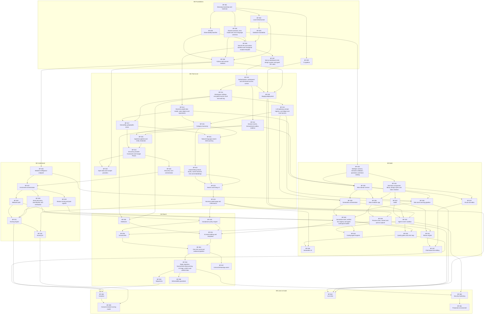

# Tickets

Every unit of work in this repository is a ticket: a Markdown file `BF-NNN-<slug>.md` in this folder, mirrored as a GitHub issue (title `BF-NNN: <title>`, labels, milestone, cross-links). **The Markdown file is the source of truth**; the issue is generated from it.

Tickets are written for AI coding agents (Claude Code, Codex, …) as much as for humans. Each one is self-contained: it explains *why*, links the docs and the tickets it builds on, defines scope and design precisely, lists tests and acceptance criteria, and ends with an **Agent prompt** to paste into an agent.

## How to work on a ticket

1. Pick a ticket whose dependencies are all merged. On GitHub, filter issues with the label **`agent:ready`**. Locally, use the **Wave** column below: a ticket can start once every ticket in its `depends_on` is merged.
2. In Claude Code run `/ticket BF-0NN` (see `.claude/commands/ticket.md`). In other agents, paste the ticket's **Agent prompt** section.
3. Follow [AGENTS.md](../../AGENTS.md) §5: branch `bf-0nn-<slug>` → plan → contracts → domain → application → infrastructure → interface → tests → `pnpm verify` → self-review → PR titled `BF-0NN: <title>` with `Closes #<issue>` (issue numbers are in [`issue-map.json`](issue-map.json)).
4. Tick the ticket's acceptance-criteria checkboxes in the same PR.

Before starting, read the tickets in `depends_on` (their code is merged; reuse it) and skim the tickets in `blocks` (they will build on your work; do not paint them into a corner).

## Anatomy of a ticket

| Section | Purpose |
|---|---|
| Frontmatter | `id`, `title`, `milestone`, `epic`, `type`, `priority` (P0 must-have … P2 later), `size` (S ≤ 1 day, M 2–3 days, L 4+ days for an agent session series; split L into stacked PRs), `depends_on`, `blocks` (derived), `areas` |
| Context | Why the work exists and what already exists (links to docs and dependency tickets) |
| Goal | The outcome in 1–3 sentences |
| Scope | Precise *in scope* list and explicit *out of scope* items with the ticket that owns them |
| Requirements | Functional and non-functional requirements specific to the ticket |
| Design | Data model, contracts, APIs, file layout, patterns and why |
| Implementation plan | Ordered steps (and suggested PR split for L tickets) |
| Testing | Unit / integration / E2E / evals expected |
| Acceptance criteria | Checkboxes that define done (plus the global Definition of Done in AGENTS.md §10) |
| Agent prompt | A ready-to-use prompt: what to read first, rules, how to verify |
| References | Docs, ADRs and external documentation |

Template: [_TEMPLATE.md](_TEMPLATE.md). To add a ticket, use `/new-ticket <description>` in Claude Code or copy the template.

## Maintaining the ticket graph

```bash
node scripts/tickets/graph.mjs            # validate ids, dependencies, cycles, milestone order, derived `blocks`
node scripts/tickets/graph.mjs --write    # rewrite `blocks` from `depends_on` + regenerate the tables below
node scripts/tickets/sync-issues.mjs --dry-run   # preview GitHub issue changes
node scripts/tickets/sync-issues.mjs             # create/update issues, labels, milestones (REST only)
node scripts/tickets/sync-issues.mjs --refresh-ready   # recompute `agent:ready` from closed issues
```

Only edit `depends_on` by hand; `blocks` and the generated sections below are derived.

## Milestones

| Milestone | Outcome |
|---|---|
| **M0 Foundations** | Monorepo, local infrastructure, database, contracts, observability, API/worker/web/intel skeletons, CI |
| **M1 Find & List** | Accounts and workspaces, business graph, discovery providers, AI search, listing UI, CRM basics, staging |
| **M2 Understand** | Website intelligence, enrichment, email verification, review mining, audits, explainable scoring |
| **M3 Build** | Website platform (SiteSpec, blocks, renderer, editor) and one-click AI site generation with multiple engines in sandboxes |
| **M4 Reach** | Compliance engine, mailboxes, AI drafting, one-click send, sequences, reply triage, unsubscribe/DSR, deliverability, call/WhatsApp assist |
| **M5 Learn & Scale** | Analytics, outcome-trained scoring, security hardening, production operations, live sites with custom domains |

See [ROADMAP.md](../ROADMAP.md) for exit criteria and parallel tracks.

## Index

<!-- INDEX:START -->
| Ticket | Title | Milestone | Epic | Priority | Size | Wave | Depends on |
|---|---|---|---|---|---|---|---|
| [BF-001](BF-001-monorepo-bootstrap.md) | Monorepo bootstrap and toolchain | M0 Foundations | foundations | P0 | M | 0 | — |
| [BF-002](BF-002-local-infrastructure.md) | Local infrastructure (Docker Compose) and environment configuration | M0 Foundations | foundations | P0 | M | 1 | BF-001 |
| [BF-003](BF-003-database-foundation.md) | Database foundation (Drizzle, extensions, migrations, test database) | M0 Foundations | foundations | P0 | M | 2 | BF-002 |
| [BF-004](BF-004-shared-contracts.md) | Shared contracts, error model and cross-language schemas | M0 Foundations | foundations | P0 | M | 1 | BF-001 |
| [BF-005](BF-005-observability-baseline.md) | Observability baseline (logging, tracing, metrics, health) | M0 Foundations | foundations | P0 | S | 1 | BF-001 |
| [BF-006](BF-006-api-and-worker-skeleton.md) | NestJS API and worker skeleton with hexagonal module template | M0 Foundations | foundations | P0 | L | 3 | BF-003, BF-004, BF-005 |
| [BF-007](BF-007-dashboard-shell.md) | Next.js dashboard shell, design system and typed API client | M0 Foundations | foundations | P0 | L | 4 | BF-006 |
| [BF-008](BF-008-intel-service-skeleton.md) | Python intel service skeleton (FastAPI, contracts codegen, SSRF-safe fetch) | M0 Foundations | foundations | P0 | M | 2 | BF-002, BF-004, BF-005 |
| [BF-009](BF-009-ci-pipeline.md) | CI pipeline (GitHub Actions) and quality gates | M0 Foundations | foundations | P0 | M | 1 | BF-001 |
| [BF-010](BF-010-auth-workspaces-rbac.md) | Authentication, workspaces and role-based access control | M1 Find & List | identity | P0 | L | 5 | BF-006, BF-007 |
| [BF-011](BF-011-workspace-settings-secrets-audit.md) | Workspace settings, encrypted secrets vault and audit log | M1 Find & List | identity | P0 | M | 6 | BF-010 |
| [BF-012](BF-012-events-outbox-realtime-notifications.md) | Domain events, transactional outbox, realtime (SSE) and notifications | M1 Find & List | foundations | P0 | L | 6 | BF-006, BF-010 |
| [BF-013](BF-013-llm-gateway.md) | LLM gateway, prompt registry, cost ledger and eval harness (@bf/ai) | M1 Find & List | ai-platform | P0 | L | 7 | BF-004, BF-005, BF-011 |
| [BF-014](BF-014-business-graph-data-model.md) | Business graph data model, value objects and repositories | M1 Find & List | business-graph | P0 | L | 4 | BF-003, BF-004, BF-006 |
| [BF-015](BF-015-category-taxonomy.md) | Category taxonomy (EN/FR), provider mappings and AI classification | M1 Find & List | business-graph | P0 | M | 8 | BF-013, BF-014 |
| [BF-016](BF-016-ingestion-entity-resolution.md) | Ingestion pipeline and entity resolution (golden records with provenance) | M1 Find & List | business-graph | P0 | L | 9 | BF-012, BF-014, BF-015 |
| [BF-017](BF-017-geocoding-areas.md) | Geocoding, geographic areas (incl. Saint-Barthélemy pack) and area tiling | M1 Find & List | business-graph | P0 | M | 7 | BF-011, BF-014 |
| [BF-018](BF-018-provider-framework-google-places.md) | Discovery provider framework and Google Places (New) provider | M1 Find & List | discovery | P0 | M | 10 | BF-011, BF-016, BF-017 |
| [BF-019](BF-019-open-data-and-scraper-providers.md) | Open-data and scraper providers (Overture, Foursquare OS Places, OSM, Maps scraper) | M1 Find & List | discovery | P1 | L | 11 | BF-008, BF-018 |
| [BF-020](BF-020-discovery-runs.md) | Discovery runs orchestration (adaptive tiling, budgets, progress, cancellation) | M1 Find & List | discovery | P0 | L | 11 | BF-012, BF-016, BF-018 |
| [BF-021](BF-021-nl-search-intent.md) | Natural-language search intent parsing (EN/FR) grounded in the taxonomy | M1 Find & List | search-listing | P0 | M | 9 | BF-013, BF-015, BF-017 |
| [BF-022](BF-022-hybrid-listing-search.md) | Hybrid listing search, facets, saved searches, lists and embeddings | M1 Find & List | search-listing | P0 | L | 9 | BF-013, BF-014, BF-015 |
| [BF-023](BF-023-search-listing-ui.md) | Search and listing UI (prompt bar, intent chips, table, map, facets, discovery panel) | M1 Find & List | search-listing | P0 | L | 12 | BF-007, BF-010, BF-020, BF-021, BF-022 |
| [BF-024](BF-024-business-detail-crm.md) | Business detail page and CRM basics (pipeline, owner, notes, tasks, activity, duplicates) | M1 Find & List | search-listing | P0 | L | 13 | BF-012, BF-016, BF-023 |
| [BF-025](BF-025-staging-deployment.md) | Staging deployment (images, compose, Caddy, deploy workflow, runbook) | M1 Find & List | ops | P0 | M | 6 | BF-002, BF-006, BF-007, BF-008, BF-009, BF-010 |
| [BF-026](BF-026-website-intelligence-service.md) | Website intelligence endpoint (crawl, extract, fingerprint, screenshots) in the intel service | M2 Understand | enrichment | P0 | L | 3 | BF-008 |
| [BF-027](BF-027-enrichment-orchestration.md) | Enrichment orchestration (step pipeline, website as a source, staleness, budgets) | M2 Understand | enrichment | P0 | L | 12 | BF-012, BF-014, BF-016, BF-020, BF-026 |
| [BF-028](BF-028-email-discovery-verification.md) | Email discovery, classification and verification | M2 Understand | enrichment | P0 | M | 13 | BF-027 |
| [BF-029](BF-029-review-mining.md) | Review mining and pain signals (licensing-gated, privacy-preserving) | M2 Understand | enrichment | P1 | M | 13 | BF-013, BF-027 |
| [BF-030](BF-030-website-audit.md) | Website audit (PageSpeed, vision grade, findings, website status) | M2 Understand | enrichment | P0 | L | 13 | BF-013, BF-026, BF-027 |
| [BF-031](BF-031-scoring-engine.md) | Scoring engine (feature registry, offer profiles, explainability, recompute) | M2 Understand | scoring | P0 | L | 14 | BF-027, BF-028, BF-029, BF-030 |
| [BF-032](BF-032-scoring-ui.md) | Scoring UI (score badges, explanations, profile editor with live preview) | M2 Understand | scoring | P1 | M | 15 | BF-023, BF-024, BF-031 |
| [BF-033](BF-033-sitespec-schema.md) | SiteSpec schema, semantic validation, operations and block catalog (@bf/site-schema) | M3 Build | site-platform | P0 | L | 2 | BF-004 |
| [BF-034](BF-034-site-blocks-library.md) | Site block component library, design styles and static renderer (@bf/site-blocks) | M3 Build | site-platform | P0 | L | 3 | BF-033 |
| [BF-035](BF-035-sites-domain-service.md) | Sites domain service (sites, immutable versions, publications, assets, views, expiry) | M3 Build | site-platform | P0 | L | 7 | BF-006, BF-012, BF-014, BF-033 |
| [BF-036](BF-036-sites-renderer.md) | Sites renderer app — multi-tenant hosting of previews on our domain (apps/sites) | M3 Build | site-platform | P0 | L | 8 | BF-034, BF-035 |
| [BF-037](BF-037-visual-editor-puck.md) | Visual site editor (Puck) with schema-driven fields, versions and publish | M3 Build | site-platform | P0 | L | 8 | BF-007, BF-034, BF-035 |
| [BF-038](BF-038-site-asset-pipeline.md) | Site asset sourcing pipeline (owner-site images, stock, AI images, logos) with licensing | M3 Build | site-platform | P0 | L | 8 | BF-013, BF-026, BF-035 |
| [BF-039](BF-039-generation-orchestration.md) | Generation orchestration — batches, prioritized per-engine queues, parallelism, failover, cancellation, budgets | M3 Build | generation | P0 | L | 8 | BF-011, BF-012, BF-013, BF-035 |
| [BF-040](BF-040-generation-brief-fact-registry.md) | Generation brief, verified fact registry and agent workspace builder | M3 Build | generation | P0 | L | 14 | BF-013, BF-015, BF-026, BF-029, BF-030, BF-033, BF-038, BF-039 |
| [BF-041](BF-041-blocks-engine.md) | Blocks engine — fast in-process LLM site composer (plan → copy → assemble → self-check) | M3 Build | generation | P0 | L | 15 | BF-013, BF-039, BF-040, BF-042 |
| [BF-042](BF-042-sitekit-cli-mcp.md) | sitekit — agent toolbelt as library, CLI and MCP server (validate, lint, render, screenshot, ops, check) | M3 Build | generation | P0 | M | 4 | BF-033, BF-034 |
| [BF-043](BF-043-agent-runner-sandbox.md) | Agent runner sandbox — hardened container image, SandboxProvider (Docker), egress allowlist proxy, framed I/O | M3 Build | generation | P0 | L | 9 | BF-002, BF-025, BF-039, BF-042 |
| [BF-044](BF-044-coding-agent-engines.md) | Coding-agent engines — Claude Code CLI, OpenAI Codex CLI and Claude Agent SDK in sandboxes | M3 Build | generation | P0 | L | 15 | BF-039, BF-040, BF-042, BF-043 |
| [BF-045](BF-045-quality-gates-critic-loop.md) | Quality gates and critic loop — facts, claims, copy, accessibility, Lighthouse, visual critic, auto-fix, repair | M3 Build | generation | P0 | L | 15 | BF-013, BF-034, BF-039, BF-040, BF-042, BF-043 |
| [BF-046](BF-046-generation-ui.md) | Generation UI — "Create sites" from selection, priorities, engines, live batch board, agent console, review queue | M3 Build | generation | P0 | L | 16 | BF-023, BF-024, BF-039, BF-040, BF-045 |
| [BF-047](BF-047-chat-site-editing.md) | Chat-based site editing (Lovable-style) — tool-using edit agent with proposals, diffs and safe apply | M3 Build | site-platform | P1 | L | 16 | BF-013, BF-035, BF-037, BF-040, BF-041 |
| [BF-048](BF-048-preview-claim-lead-capture.md) | Preview claim, contact and opt-out capture — public leads API, anti-spam, CRM automation, leads inbox | M3 Build | site-platform | P0 | L | 14 | BF-012, BF-024, BF-035, BF-036 |
| [BF-049](BF-049-compliance-policy-engine.md) | Compliance policy engine — jurisdiction policies, mandatory decision gate, suppression core, lawful basis, legal review | M4 Reach | compliance | P0 | L | 14 | BF-011, BF-012, BF-015, BF-017, BF-024, BF-026, BF-028 |
| [BF-050](BF-050-mailboxes.md) | Mailboxes — Gmail/Workspace, Microsoft 365 and SMTP/IMAP adapters, caps, ramp-up, sending windows, rotation | M4 Reach | outreach | P0 | L | 7 | BF-010, BF-011, BF-012 |
| [BF-051](BF-051-ai-drafting-templates.md) | AI email drafting and templates — grounded personalization, subject variants, recipient language, composer UI | M4 Reach | outreach | P0 | L | 15 | BF-013, BF-024, BF-030, BF-035, BF-040, BF-049, BF-050 |
| [BF-052](BF-052-one-click-send-outbound-pipeline.md) | One-click send and outbound pipeline — compliance-gated outbox, MIME + RFC 8058 headers, exactly-once send, bulk approval | M4 Reach | outreach | P0 | L | 16 | BF-049, BF-050, BF-051, BF-055 |
| [BF-053](BF-053-sequences.md) | Sequences — multi-step follow-ups in business days, stop conditions, A/B variants, preview-view conditions | M4 Reach | outreach | P1 | L | 18 | BF-024, BF-035, BF-049, BF-051, BF-052, BF-054 |
| [BF-054](BF-054-reply-ingestion-triage-inbox.md) | Reply ingestion, bounce/auto-reply parsing, AI triage, actions and unified inbox | M4 Reach | outreach | P0 | L | 17 | BF-013, BF-049, BF-050, BF-051, BF-052 |
| [BF-055](BF-055-unsubscribe-suppression-dsr-retention.md) | Unsubscribe (RFC 8058) and suppression management, data-subject requests, retention jobs, data map | M4 Reach | compliance | P0 | L | 15 | BF-011, BF-012, BF-048, BF-049 |
| [BF-056](BF-056-deliverability-guardrails.md) | Deliverability guardrails — DNS authentication checks, auto-pause thresholds, kill switch, health dashboard | M4 Reach | outreach | P1 | M | 18 | BF-050, BF-052, BF-054 |
| [BF-057](BF-057-call-whatsapp-assist.md) | Call and WhatsApp assist — AI call scripts, best time to call, click-to-call, wa.me drafts, outcome logging, mobile call list | M4 Reach | outreach | P1 | M | 17 | BF-024, BF-040, BF-049, BF-051, BF-052 |
| [BF-058](BF-058-analytics.md) | Analytics — funnel and conversion by niche, area, offer, tier, template and engine; preview engagement; unit economics | M5 Learn & Scale | analytics | P1 | L | 19 | BF-012, BF-031, BF-039, BF-045, BF-048, BF-052, BF-053, BF-054 |
| [BF-059](BF-059-outcome-model.md) | Outcome-trained scoring model — dataset builder, training in intel, ONNX scoring, shadow mode, promotion, drift monitoring | M5 Learn & Scale | scoring | P2 | L | 20 | BF-008, BF-031, BF-032, BF-058 |
| [BF-060](BF-060-security-hardening-threat-model.md) | Security hardening — threat model, Postgres RLS defense in depth, sandbox and secrets hardening, ASVS review | M5 Learn & Scale | ops | P0 | L | 18 | BF-010, BF-011, BF-036, BF-043, BF-048, BF-052, BF-054 |
| [BF-061](BF-061-production-deployment-observability-backups.md) | Production environment — releases, zero-downtime deploys, PITR backups and restore drills, monitoring, alerting, SLOs | M5 Learn & Scale | ops | P0 | L | 19 | BF-005, BF-025, BF-043, BF-060 |
| [BF-062](BF-062-live-sites-custom-domains-handover.md) | Live sites — go-live wizard, custom domains with on-demand TLS, legal pages, client handover, static export, SaaS readiness | M5 Learn & Scale | site-platform | P1 | L | 15 | BF-024, BF-025, BF-035, BF-036, BF-038, BF-048 |
<!-- INDEX:END -->

## Waves (what can run in parallel)

A ticket's wave is the length of its longest dependency chain. Tickets in the same wave never depend on each other, so separate agents can build them in parallel (one git worktree each; see [git-workflow.md](../conventions/git-workflow.md)). Not every ticket of a wave has to wait for the whole previous wave: only its own `depends_on` must be merged.

<!-- WAVES:START -->
| Wave | Tickets that can start once all earlier waves they depend on are merged |
|---|---|
| 0 | BF-001 |
| 1 | BF-002, BF-004, BF-005, BF-009 |
| 2 | BF-003, BF-008, BF-033 |
| 3 | BF-006, BF-026, BF-034 |
| 4 | BF-007, BF-014, BF-042 |
| 5 | BF-010 |
| 6 | BF-011, BF-012, BF-025 |
| 7 | BF-013, BF-017, BF-035, BF-050 |
| 8 | BF-015, BF-036, BF-037, BF-038, BF-039 |
| 9 | BF-016, BF-021, BF-022, BF-043 |
| 10 | BF-018 |
| 11 | BF-019, BF-020 |
| 12 | BF-023, BF-027 |
| 13 | BF-024, BF-028, BF-029, BF-030 |
| 14 | BF-031, BF-040, BF-048, BF-049 |
| 15 | BF-032, BF-041, BF-044, BF-045, BF-051, BF-055, BF-062 |
| 16 | BF-046, BF-047, BF-052 |
| 17 | BF-054, BF-057 |
| 18 | BF-053, BF-056, BF-060 |
| 19 | BF-058, BF-061 |
| 20 | BF-059 |
<!-- WAVES:END -->

## Dependency graph

Arrows point from a ticket to the tickets that build on it. The graph is *transitively reduced*: an arrow implied by a longer path is omitted, so it shows the essential order. The full `depends_on` list of each ticket is in the index above and in its frontmatter.

<!-- GRAPH:START -->

<!-- GRAPH:END -->
